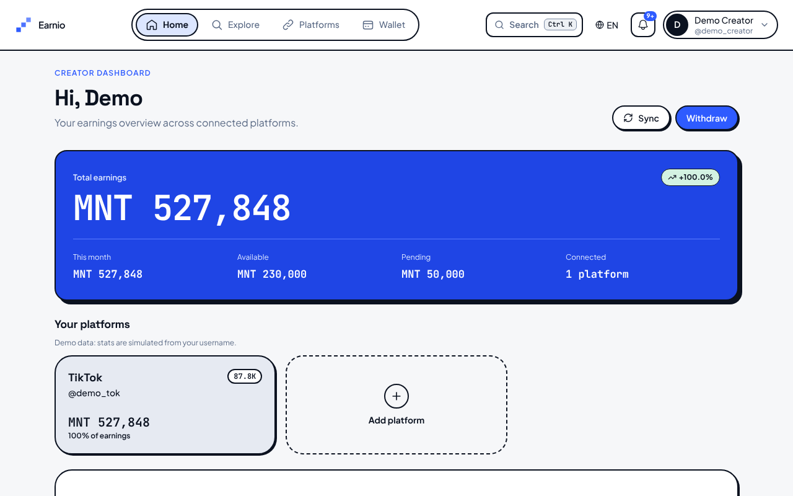
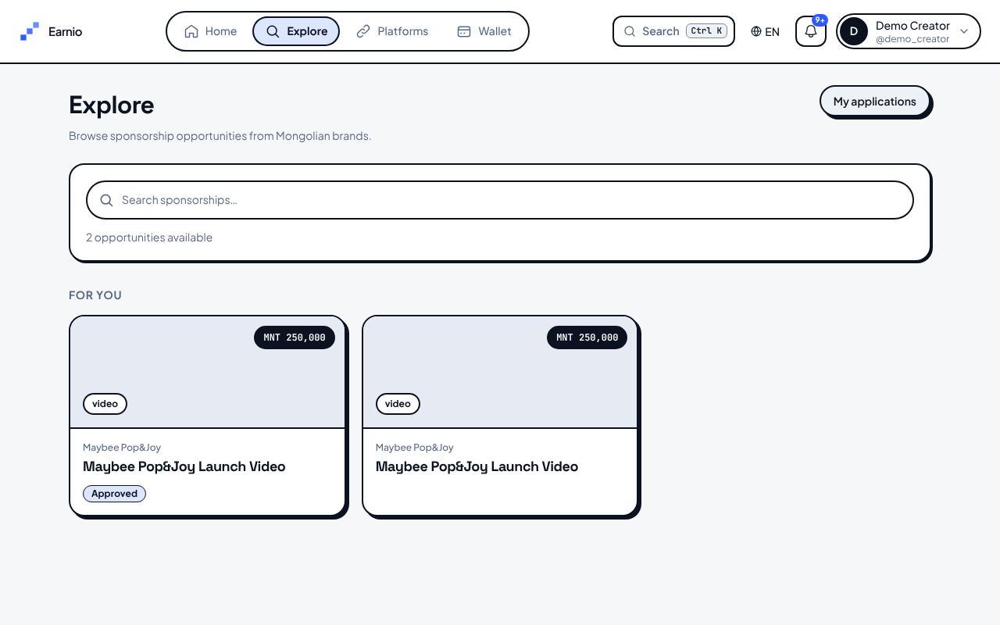
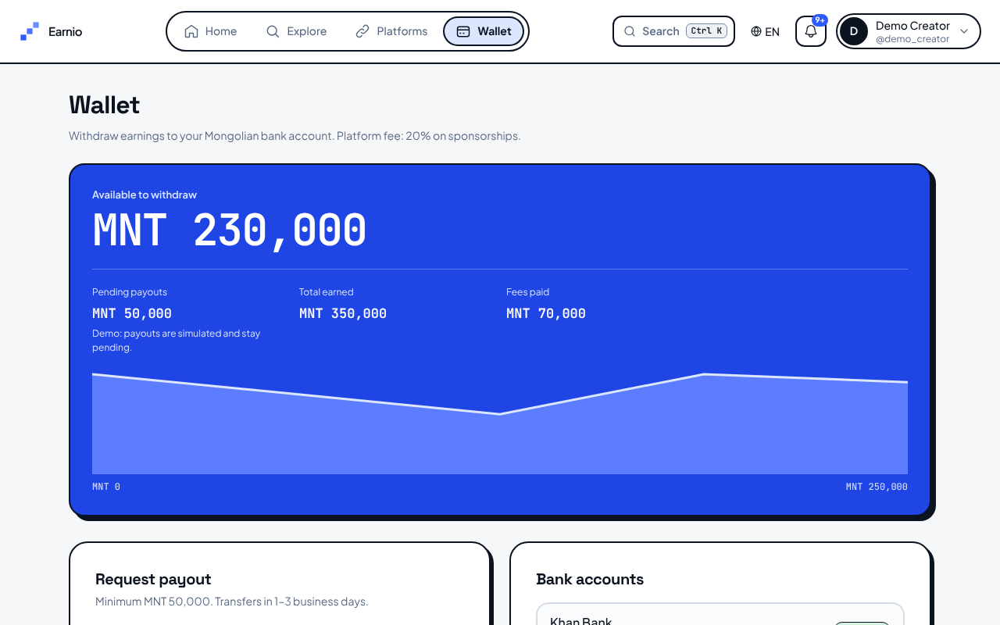
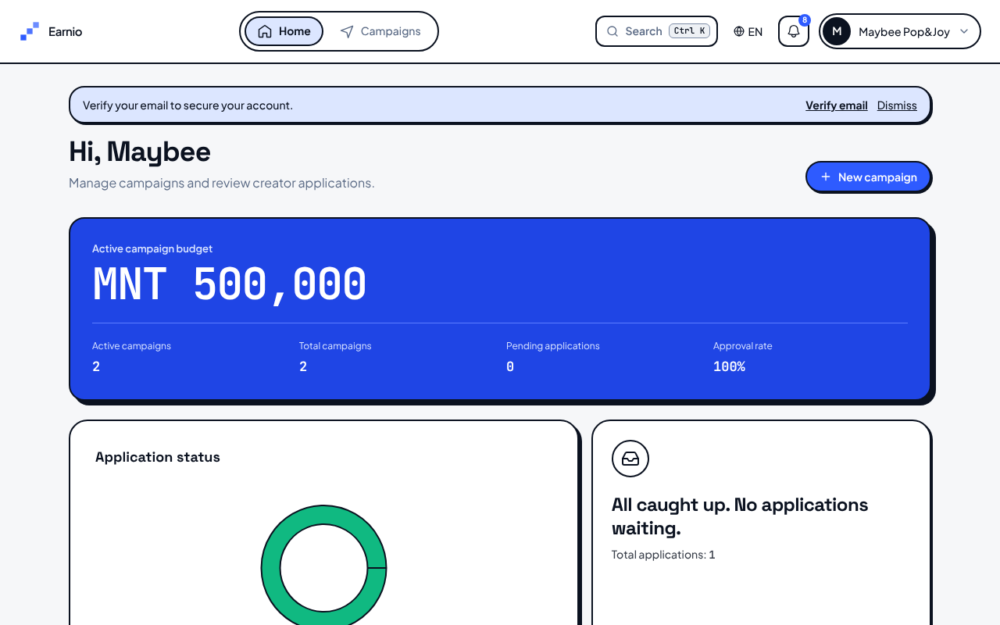

# Earnio

**Earn more, create more.**

UGC monetization platform for Mongolian Gen Z creators and brands. Creators connect their TikTok/YouTube/Instagram, track earnings, apply to brand sponsorship campaigns, and request MNT payouts. Brands post campaigns, review applications, and approve creators. Earnio takes a 20% commission on sponsorships; creators keep 80%.

This is a solo-built, full-stack portfolio project, not a live startup. Platform stats and bank payouts are intentionally **simulated** (see [What's real and what's simulated](#whats-real-and-whats-simulated)). Everything else (auth, RLS-backed Postgres, the sponsorship marketplace, deliverable review, wallet ledger, notifications, EN/MN i18n) is real, working code with backend, frontend, database and e2e tests.

`Next.js 16` · `React 19` · `Express 5` · `TypeScript` · `Supabase (Postgres + JWT)` · `Tailwind 4`

→ **Full project map:** [context.md](./context.md) · **Demo walkthrough:** [docs/APP_OVERVIEW.md](./docs/APP_OVERVIEW.md#demo-walkthrough-portfolio)

---

## Live demo

<!-- Add the Vercel URL here after deploying (docs/DEPLOYMENT.md), then run `npm run seed:demo` against it. -->
Not deployed yet. Deploy guide: [docs/DEPLOYMENT.md](./docs/DEPLOYMENT.md) (Vercel + Render + Supabase, free tiers).

## Screenshots

| Creator dashboard | Explore sponsorships |
|---|---|
|  |  |
| **Wallet** | **Sponsor dashboard** |
|  |  |

## What's real and what's simulated

| Part | Status |
|------|--------|
| Sign up, login, email verification, password reset, Google/Apple sign-in | Real (Supabase Auth) |
| Campaigns, applications, approvals, deliverable links, deliverable approval | Real |
| Wallet ledger: 80% to the creator, 20% platform fee | Real (database rows, enforced by RLS and triggers) |
| Platform stats (followers, earnings) | **Simulated** from the username you enter; no TikTok/YouTube/Instagram login |
| Brand payment ("Mark as paid") | **Simulated**: the sponsor confirms payment, no money moves |
| Creator payouts | **Simulated**: requests are recorded and stay pending |

How a real version would work (research summary in [docs/SHIP_PLAN.md](./docs/SHIP_PLAN.md)): brands prepay through QPay or a bank invoice, creators post and submit the link (already built), the brand approves it (already built), and an admin batches payouts weekly.

---

## Quick start

**Prerequisites:** Node.js 20+, npm, Supabase project with migrations applied.

```bash
npm install
cd frontend && npm install && cd ../backend && npm install

cp backend/.env.example backend/.env
# Set SUPABASE_URL, SUPABASE_ANON_KEY, SUPABASE_SERVICE_ROLE_KEY, FRONTEND_URL

echo "NEXT_PUBLIC_API_URL=http://localhost:3001" > frontend/.env.local

npm run dev          # from repo root — frontend :3000 + backend :3001
```

- **Web:** http://localhost:3000  
- **API health:** http://localhost:3001/api/health  
- **Creator signup:** http://localhost:3000/signup/creator  

**Docker:** `docker compose up --build`

**Want realistic demo data instead of clicking through the whole flow by hand?** With both servers running:

```bash
npm run seed:demo
```

This drives the real API to create a demo sponsor + campaign, a demo creator, an application, an approval, an approved deliverable, a mark-paid wallet credit, and a payout request — see [Commands](#commands).

---

## Repository layout

| Folder | What |
|--------|------|
| [frontend/](./frontend/) | Next.js website |
| [backend/](./backend/) | Express REST API |
| [supabase/](./supabase/) | SQL migrations |
| [docs/](./docs/) | Technical documentation |
| [scripts/](./scripts/) | Dev & smoke-test helpers |

Each folder has its own `README.md`. See [context.md](./context.md) for the complete map.

---

## Environment variables

### Backend (`backend/.env`)

| Variable | Purpose |
|----------|---------|
| `SUPABASE_URL`, `SUPABASE_ANON_KEY`, `SUPABASE_SERVICE_ROLE_KEY` | Database & auth |
| `FRONTEND_URL` | CORS origin (default `http://localhost:3000`) |
| `RESEND_API_KEY`, `EMAIL_FROM` | Email (optional in dev) |
| `ENABLE_SYNC_CRON`, `SYNC_CRON_SECRET` | Platform sync scheduler |

See `backend/.env.example` for the full list.

### Frontend (`frontend/.env.local`)

| Variable | Purpose |
|----------|---------|
| `NEXT_PUBLIC_API_URL` | Backend URL (default `http://localhost:3001`) |
| `API_PROXY_TARGET` | Production only: API origin that `/api/*` is proxied to. Set `NEXT_PUBLIC_API_URL=/` with it ([deploy guide](./docs/DEPLOYMENT.md)) |

---

## Commands

| Command | Description |
|---------|-------------|
| `npm run dev` | Start frontend + backend |
| `npm run dev:frontend` | Next.js only |
| `npm run dev:backend` | Express only |
| `npm run build` | Production build (frontend) |
| `npm run lint` | ESLint (frontend) |
| `npm test` | Backend tests (run from `backend/`) |
| `npm run smoke` | HTTP smoke tests |
| `npm run seed:demo` | Seeds a full demo sponsor+creator flow via the live API (servers must be running) |
| `cd frontend && npm run test:e2e` | Playwright E2E (servers must be running) |

**Playwright:** start `npm run dev`, then `cd frontend && npm run test:e2e:install` (once) and `npm run test:e2e`. Happy-path skips if the API health check fails. See [docs/APP_OVERVIEW.md](./docs/APP_OVERVIEW.md) for the demo walkthrough and Resend notes.

---

## Documentation

| Topic | Document |
|-------|----------|
| **Start here** | [context.md](./context.md) |
| Architecture | [docs/ARCHITECTURE.md](./docs/ARCHITECTURE.md) |
| Features & status | [docs/FEATURES.md](./docs/FEATURES.md), [docs/APP_OVERVIEW.md](./docs/APP_OVERVIEW.md) |
| Frontend UI | [docs/FRONTEND.md](./docs/FRONTEND.md) |
| Deploy | [docs/DEPLOYMENT.md](./docs/DEPLOYMENT.md) |
| QA | [docs/QA_MANUAL_CHECKLIST.md](./docs/QA_MANUAL_CHECKLIST.md) |
| MVP scope | [instructions.md](./instructions.md) |
| Security | [SECURITY_AUDIT.md](./SECURITY_AUDIT.md) |
| Agents (Cursor) | [AGENTS.md](./AGENTS.md) |

In-app guides: http://localhost:3000/docs

---

## License

Private project. All rights reserved.
